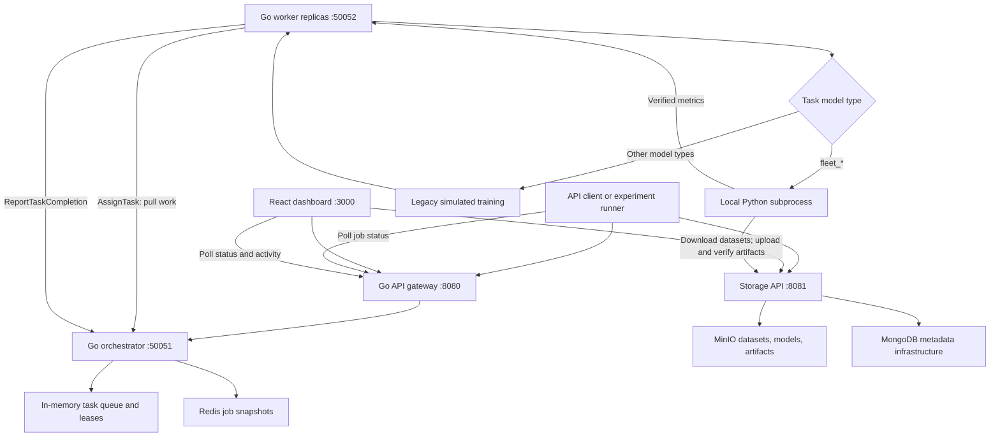
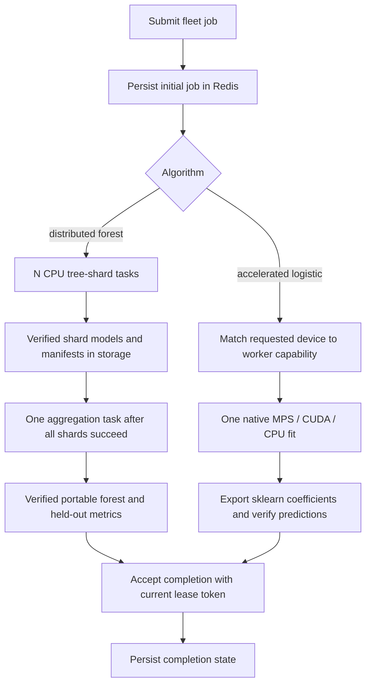

# TensorFleet application flow

Updated 16 October 2026 for `feat/real-fleet-training`.

TensorFleet accepts jobs through its Go API gateway and distributes tasks to
Go workers through the orchestrator's pull queue. Jobs using an explicit
`fleet_*` model type execute real scikit-learn training inside the assigned
worker. Basic estimators fit on one worker. `fleet_distributed_random_forest`
fits disjoint tree ranges on several CPU workers and aggregates one model.
`fleet_accelerated_logistic` runs on a compatible native CPU, MPS, or CUDA worker.
Apple GPU workers run natively; the Docker deployment uses CPU workers.

## 1. Entry points and execution paths



The diagram shows the current service roles. The fleet trainer uses the storage
service's object upload/download endpoints, which write to MinIO directly; its
model objects are not registered in MongoDB's model registry in this version.

The separate `worker-ml` HTTP service on port 8000 remains another real-training
path. Its `/train` endpoint uses a local thread pool and its own status endpoint.
It is not called by the new Go-worker fleet path. The dashboard's existing model
presets are not automatically converted to `fleet_*` jobs; the MNIST experiment
submits these explicitly through the gateway API.

## 2. Dataset preparation and upload

The client prepares datasets and uploads them using:

```text
POST /api/v1/upload/datasets/<object-name>   multipart field: file
GET  /api/v1/download/datasets/<object-name>
```

Dataset paths in job requests use `datasets/<object-name>` or
`s3://datasets/<object-name>`. CSV inputs contain the named target column. NPZ
inputs contain `X` shaped `(rows, features)` and `y` shaped `(rows,)`, loaded
without allowing pickled object arrays. The trainer generates feature names for
NPZ inputs and uses the requested target-column name for labels.

For explicit partitions, the primary dataset is used for fitting and the
hyperparameters contain both `validation_dataset_path` and `test_dataset_path`.
All three schemas must match. Without those two paths, the trainer creates a
seeded, stratified train/test split from the primary dataset.

## 3. Submit and schedule a real job

The client calls `POST http://localhost:8080/api/v1/jobs`. Supported real fleet
types are `fleet_random_forest`, `fleet_logistic_regression`, and
`fleet_decision_tree`.

```json
{
  "model_type": "fleet_random_forest",
  "dataset_path": "datasets/mnist/train.npz",
  "epochs": 1,
  "hyperparameters": {
    "target_column": "label",
    "random_state": "42",
    "validation_dataset_path": "datasets/mnist/validation.npz",
    "test_dataset_path": "datasets/mnist/test.npz",
    "estimator_params": "{\"n_estimators\":40,\"max_depth\":20,\"max_features\":\"sqrt\"}"
  }
}
```

The paths above are illustrative; upload those objects first. The MNIST runner
uses checksum-prefixed paths recorded in [the dataset evidence](../result/mnist-data.json).
Every hyperparameter value is a string, including the JSON-encoded estimator
parameters, to match the existing API/protobuf map.

1. The gateway generates a job ID and forwards the request to
   `CreateTrainingJob` over gRPC.
2. The orchestrator validates the fleet algorithm, `epochs=1`, and the required
   target column. Invalid fleet requests return HTTP 400 through the gateway.
3. It persists the initial private snapshot in Redis before admitting work.
   A persistence failure returns HTTP 503 without enqueueing an orphan job.
   Queue saturation returns HTTP 429 with `Retry-After`.
4. Basic estimators enqueue one complete fit. A distributed forest enqueues N
   tree shards and retains one waiting aggregation task. Live leases and queues
   are in memory; durable task snapshots enable coordinator restart recovery.
5. The gateway returns HTTP 202 with `job_id`, `status`, and `num_tasks`
   (one for a basic fit, N+1 for a distributed forest).

`epochs` defaults to one for fleet jobs. A forest is divided by deterministic
ranges of trees, never independent epoch/batch fits. `num_workers` specifies
shards for distributed forests and does not reserve physical workers. Deployment
replicas and available worker task slots determine concurrency.

## 4. Worker execution and verified completion

```mermaid
sequenceDiagram
    participant C as Client
    participant G as Gateway
    participant O as Orchestrator
    participant W as Go worker
    participant P as Python trainer
    participant S as Storage API
    participant M as MinIO

    C->>G: POST /api/v1/jobs (fleet_*)
    G->>O: CreateTrainingJob
    O-->>G: One queued task; job RUNNING
    G-->>C: HTTP 202 and job_id
    W->>O: AssignTask(worker_id)
    O-->>W: Dataset paths and hyperparameters; record lease
    W->>P: Start local subprocess; JSON request on stdin
    P->>S: Download training and optional validation/test datasets
    S->>M: Read dataset objects
    M-->>P: Dataset bytes through storage API
    Note over P: Fit preprocessing and classifier on training data only
    Note over P: Evaluate held-out data; serialize complete pipeline
    P->>S: Upload unique model object
    S->>M: Store model bytes
    P->>S: Download saved model
    Note over P: Check SHA-256; reload; compare test predictions
    P->>S: Upload result manifest, then read it back
    S->>M: Store manifest
    P-->>W: Verified result JSON and real metrics
    W->>O: ReportTaskCompletion(success=true, loss, accuracy)
    O-->>W: Acknowledge completion
    C->>G: GET /api/v1/jobs/:id
    G->>O: GetJobStatus
    O-->>C: COMPLETED, metrics, manifest URI through gateway
```

Each worker polls for tasks, bounded by `MAX_CONCURRENT_TASKS`. It passes job,
task, and worker IDs plus the dataset path and parameters to `fleet_trainer.py`.
The trainer fits imputation, scaling, and categorical encoding on training data
only and saves them with the classifier as one pipeline. Explicit validation
and test partitions are evaluated without fitting preprocessing or selecting
model parameters on those partitions.

Before reporting success, the trainer verifies the downloaded model checksum
and all reloaded test predictions, then verifies the saved manifest by reading
it back. The Go worker reports test log loss and test accuracy to the
orchestrator. The legacy metadata-only auto-save endpoint is skipped for real
fleet jobs because the worker has already stored a real model.

## 5. Retrieve results

Poll `GET /api/v1/jobs/<job-id>`. A completed real fleet job returns its manifest
URI in the existing `message` field:

```text
s3://artifacts/fleet/<job-id>/result.json
```

Retrieve that object through the storage API:

```text
GET http://localhost:8081/api/v1/download/artifacts/fleet/<job-id>/result.json
```

The manifest identifies the actual worker and attempt, dataset hashes, split
details, model settings, train/test metrics, optional validation metrics,
package versions, and the model artifact URI/checksum. Model objects use a
unique path per execution attempt:

```text
s3://models/fleet/<job-id>/<task-id>/<attempt-id>/model.pkl
```

The client downloads the pipeline using
`GET /api/v1/download/models/fleet/<job-id>/<task-id>/<attempt-id>/model.pkl`.
The experiment runner checks the hash, reloads that model, independently
evaluates all partitions, and saves evidence locally. These fleet artifacts
currently use object storage rather than the model-registry UI.

## 6. Failure, cancellation, and recovery

- Missing datasets, invalid training parameters, upload/download failures,
  checksum mismatches, or prediction mismatches prevent successful completion.
  A reported real-training failure becomes terminal `FAILED`, with zero
  successful tasks for the one-task job and an error in the status message.
- `DELETE /api/v1/jobs/<job-id>` requests cancellation. The worker checks status
  before execution and periodically during the Python subprocess, terminating
  it when cancellation or failure is observed. Terminal cancelled/failed fleet
  jobs ignore late completion reports. Artifacts already uploaded are not
  automatically deleted.
- Python execution has a 240-second timeout. The default task lease is five
  minutes; there is no lease-renewal/checkpoint-resume protocol for long fits.
- If a worker disappears, the existing lease reaper can requeue its task.
  Unique attempt paths preserve separate model objects, but result-manifest
  publication is not an exactly-once transaction.
- Private Redis snapshots restore unfinished tasks on coordinator startup with
  fresh lease tokens. Completed task IDs prevent duplicate accounting; stale
  attempts cannot complete a newer lease. Admission requires Redis persistence
  unless `ALLOW_EPHEMERAL_JOBS=true` is explicitly enabled. Recovery assumes
  Redis state survives; it does not provide checkpoint resume or exactly-once
  artifact publication.

## 7. MNIST experiment and saved evidence

The verified experiment is driven by [run_mnist_fleet.py](../benchmarks/run_mnist_fleet.py):

1. Download the official MNIST archive and verify its SHA-256.
2. Stratify the original 60,000 training images into 50,000 training and 10,000
   validation examples with seed 2026. Keep the official 10,000 test examples
   separate and flatten images into 784 pixel features.
3. Upload and checksum the three NPZ partitions through the real storage API.
4. Submit three fixed random-forest configurations using seeds 42, 43, and 44,
   with 40 trees, depth 20, and `max_features=sqrt`.
5. Run them across two Docker workers, each with one CPU, 2 GiB memory, one
   task slot, and one numerical-library thread.
6. Download all saved models and independently reproduce train, validation,
   and test metrics. Save manifests, model files, predictions, per-class
   reports, confusion matrices, source/data hashes, image IDs, and timings
   under `result/`.
7. Run [deployment checks](../result/verify_deployment.py) for invalid input,
   missing data, storage outage, and MinIO restart persistence.

The run passed, with mean validation accuracy **96.597%** and mean official
test accuracy **96.367%** across three seeds. See
[the result report and reproduction commands](../result/README.md) and
[raw run measurements](../result/mnist-run.json).

The Docker test deployment uses local MongoDB, Redis, and MinIO, with the
[test Compose override](../result/compose.override.yml). Its MinIO image builds
from a pinned official upstream source revision. The frontend, separate
`worker-ml` service, and model-registry UI were not part of that test.

The original experiment establishes independent fits and verified artifacts.
The subsequent flow below adds distributed forest construction, repeated scaling
trials and direct process-pool controls. Distributed neural training remains open.

## 8. Distributed forest and native accelerator flow



For a distributed forest, `num_workers` specifies N shards, not reserved physical
workers. There are N+1 successful tasks including aggregation. Global per-tree
seeds stay identical across shard counts. Every shard receives the full training
data; this distributes trees, not data capacity. Aggregation checks hashes,
preprocessing, classes, versions, and tree ranges before joining estimators.

Workers advertise supported algorithm/device pairs. Incompatible tasks remain
deferred while compatible CPU work proceeds. `worker/launch_fleet.py` starts a
conservative number of native workers based on estimated memory and CPU limits.
The planner is a heuristic; measured performance can favor fewer workers. One
M4 GPU is a single accelerator, not three independently addressable GPUs.

The repeated experiments, baselines, fault injections and remaining limitations
are indexed in [research results](../result/research/README.md).
